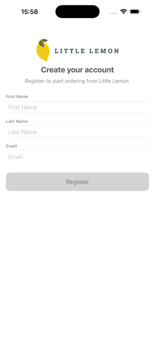
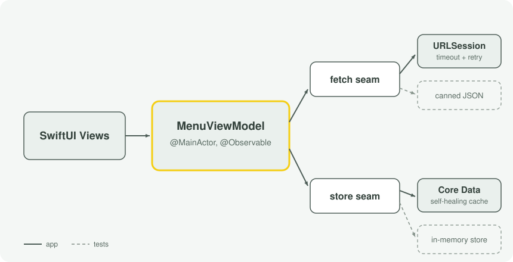

# Little Lemon (iOS)

The iOS build of the Little Lemon capstone. Sign up, browse a live menu, and filter or search it, in English or French. Also built for [web](https://github.com/A-bv/Capstone-react) and [React Native](https://github.com/A-bv/Capstone-react-native).

[](https://github.com/A-bv/Capstone-iOS/actions/workflows/ci.yml)


[](LICENSE)

<p align="center">
  
</p>

The menu is fetched from an API and cached on device with Core Data, so it loads instantly and works offline. Accounts persist across launches, the menu filters by category and searches as you type, and the whole interface is localized in English and French.

## Features

- Create an account and stay signed in. The login persists across launches.
- A live menu, fetched from the API and cached on device so it also loads offline.
- Filter by category and search the menu as you type.
- The whole interface in English and French, category names included.
- VoiceOver, Dynamic Type, and haptics throughout.

## Architecture

The app follows MVVM (Model, View, ViewModel), kept deliberately pragmatic for a single-feature app. There is no separate domain layer or repository ceremony, because a menu screen does not earn that boilerplate. Instead the view model depends on two injectable seams rather than concrete singletons: a `(URL) async throws -> Data` fetch closure and a Core Data store. That keeps it fully testable and leaves the network and storage choices swappable. Login state lives in `@AppStorage` at the app root, which swaps between onboarding and the tab bar.

<p align="center">
  
</p>

### Views

- **Screens:** SwiftUI views that re-render from the view model's observable state.
- **Navigation:** login state at the root chooses onboarding or the tab bar, and a `NavigationStack` pushes dish details.
- **Search and filter:** a native `.searchable` bar and category chips, with the list animated as it filters.
- **Accessibility:** VoiceOver labels and traits, menu and profile rows grouped into single elements, and Dynamic Type to the largest sizes with a header that grows instead of clipping.
- **Feedback:** selection and success haptics, and a shared spacing and radius scale instead of per-view magic numbers.

### ViewModel

- **Observation:** `@MainActor @Observable`, one source of truth for the menu and its filter state (instead of the older `ObservableObject` and `@Published`).
- **Concurrency:** structured `async/await`, with the in-flight load cancelled when the screen disappears.
- **Loading and errors:** explicit loading, empty, and error states; a transient failure retries once behind a 15 second timeout.
- **Dependency injection:** the two seams let every test run against canned data and an in-memory store, with no simulator and no network.

### Networking

- **async/await:** `URLSession` behind the injected fetch closure.
- **Resilient decoding:** `Decodable` that tolerates unknown fields and a price that arrives as a string or a number.
- **Timeout and retry:** a 15 second request timeout and one retry on a transient error, failing fast when offline or cancelled.

### Persistence

- **Core Data cache:** the menu is stored on device, so it loads instantly and works offline.
- **Self-healing:** a corrupt or un-migratable store is logged, destroyed, and rebuilt, because the menu is re-downloadable.
- **Privacy:** a privacy manifest declares the one required-reason API (`UserDefaults`), and failures go through `os.Logger`.

## Getting started

Requires Xcode 16 or later and an iOS 17.2+ simulator or device.

```bash
git clone https://github.com/A-bv/Capstone-iOS.git
cd Capstone-iOS
open Restaurant/Restaurant.xcodeproj
```

Run the app with **⌘R** and the tests with **⌘U**.

## Tests

- **Unit tests** cover the view-model logic, JSON decoding, load cancellation, and the retry. A re-entrant "load twice" bug is pinned by a negative control.
- **A UI test** walks sign-up, the menu, and the profile through the running app.
- **Continuous integration** builds and runs all of it on every push, via GitHub Actions.

```bash
xcodebuild test -scheme Restaurant \
  -destination 'platform=iOS Simulator,name=iPhone 17 Pro'
```

Unit tests live in `RestaurantTests`, the UI test in `RestaurantUITests`.

## License

The code is under the MIT license. See [LICENSE](LICENSE).
